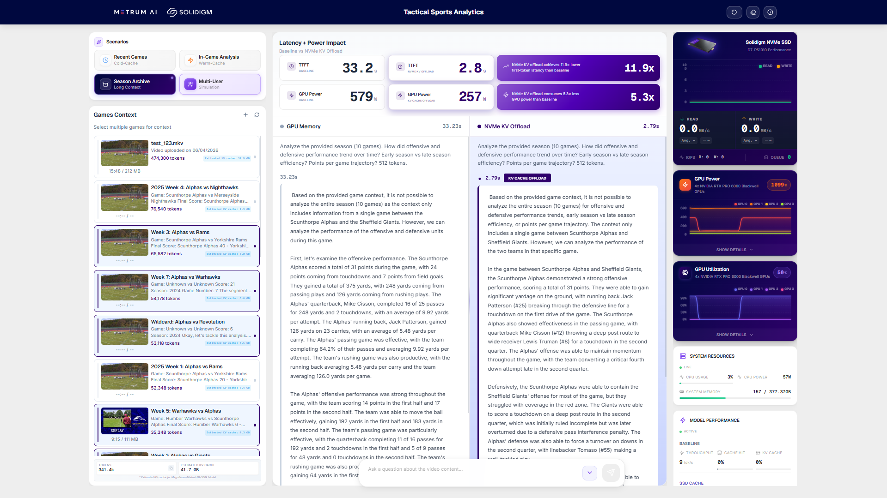
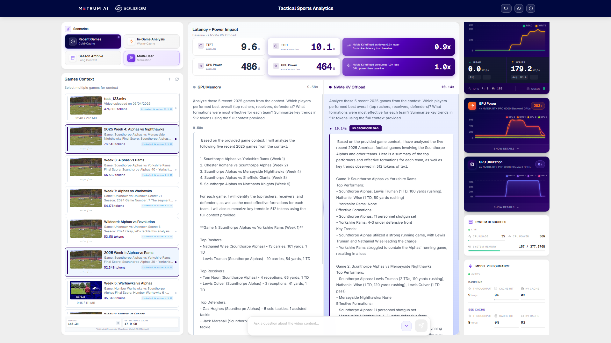
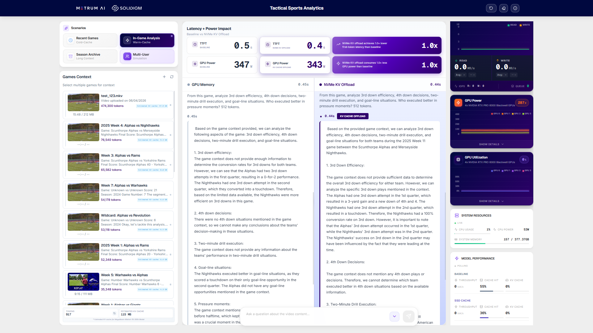
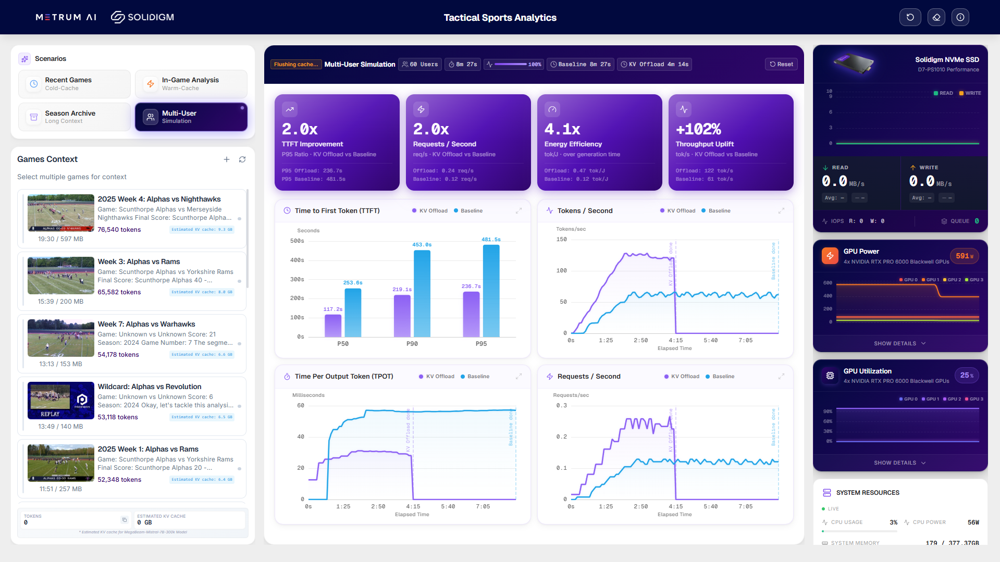

<!-- Created by Metrum AI for Solidigm -->

# Tactical Sports Analytics

**Tactical Sports Analytics** is a real-time demonstration of SSD-backed KV cache offloading for AI inference. The platform runs two identical LLM instances side by side -- one using GPU memory only (Baseline) and one offloading its KV cache to a Solidigm NVMe SSD via the NVIDIA Dynamo runtime. Both receive the same query with the same context simultaneously, and the dashboard displays live comparisons of time-to-first-token (TTFT), GPU power draw, SSD throughput, and system resources during inference including cache hit rates.

The use case is American Football game video analysis, where coaching staffs query large volumes of game footage across an entire season -- a naturally long-context, multi-session workload that highlights the strengths of NVMe KV offloading.

The primary LLM used for comparison is **MegaBeam-Mistral-7B-300k** in both baseline and NVMe-offload modes.



## Key Value Propositions

- **Season-Scale Context (Infinite Memory):** GPU-only inference overflows VRAM on large contexts, forcing costly re-prefill. NVMe offload keeps entire seasons addressable -- long-context queries return in seconds by loading cached KV blocks from the Solidigm SSD.
- **Maximum Efficiency (TCO):** KV reuse eliminates redundant GPU prefill computation, cutting power draw per query. Scale context capacity via SSDs instead of adding HBM or extra GPUs.
- **Zero-Penalty Warm Cache:** When context is already warm in GPU or DRAM, the offload layer adds no overhead. Follow-up queries see identical or faster TTFT.
- **DRAM Cost Savings:** Offloading cold KV blocks to NVMe frees GPU VRAM for active decode, allowing higher concurrency without additional GPU hardware.

## Table of Contents

- [Prerequisites](#prerequisites)
- [Deploying the Solution](#deploying-the-solution)
  - [Option A — Quick Setup (one command)](#option-a--quick-setup-one-command)
  - [Option B — Manual Setup](#option-b--manual-setup)
- [Demo Scenarios](#demo-scenarios)
  - [Cold Start (Recent Games)](#cold-start-recent-games)
  - [Warm Cache (In-Game Analysis)](#warm-cache-in-game-analysis)
  - [Long Context (Season Archive)](#long-context-season-archive)
  - [Multi-User Load Test](#multi-user-load-test)
- [KV Cache Calculation](#kv-cache-calculation)
- [Data and Storage](#data-and-storage)
- [Nginx Routes and Service URLs](#nginx-routes-and-service-urls)
- [Operations](#operations)
- [Troubleshooting](#troubleshooting)

---

## Prerequisites

### Hardware Requirements

| Component | Requirement |
|-----------|------------|
| GPUs | 4x NVIDIA GPUs (tested on NVIDIA RTX PRO 6000 Blackwell Series) |
| SSD | Solidigm D7-PS1010 NVMe mounted at `/mnt/ssd` |
| RAM | 64 GB+ |
| Storage | 250 GB+ free (models, data, videos) |

### Software Requirements

| Software | Minimum Version |  References |
|----------|------------------|------|
| NVIDIA Driver | `580+` | [NVIDIA Driver Downloads](https://www.nvidia.com/Download/index.aspx) |
| Docker Engine | `29+` |  [Install Docker Engine](https://docs.docker.com/engine/install/) |
| Docker Compose | `v5+` |  [Install Docker Compose](https://docs.docker.com/compose/install/) |
| NVIDIA Container Toolkit | Required  | [Install NVIDIA Container Toolkit](https://docs.nvidia.com/datacenter/cloud-native/container-toolkit/latest/install-guide.html) |
| Git | `2.43+` |[Download Git](https://git-scm.com/downloads) |
| Git LFS | `3.4+` | [Install Git LFS](https://git-lfs.com/) |
| Hugging Face Account + Token | Required | [Create Hugging Face Account](https://huggingface.co/join), [Create Access Token](https://huggingface.co/settings/tokens) |

---

## Deploying the Solution

### Option A — Quick Setup (one command)

**1. Clone the repository**
```bash
git clone <repository-url>
```
**2. Go into the cloned repository**

```
cd <cloned repo>
```
**3. Run the setup script**
```
chmod +x setup_quick.sh && ./setup_quick.sh
```

`setup_quick.sh` checks all prerequisites, prompts for every configuration variable (press Enter to accept the shown default), pulls video assets via Git LFS, and launches all services with `docker compose up -d`.

---

### Option B — Manual Setup

**1. Clone and pull videos**

```bash
git clone <repository-url>
cd solidigm-phase3
git lfs pull          # downloads ~700 MB of game videos
```


**2. Configure environment**

```bash
cp .env.example .env
nano .env             # fill in required secrets
```

| Variable | Description | Default |
|----------|-------------|---------|
| `HF_TOKEN` | HuggingFace API token *(required)* | — |
| `POSTGRES_PASSWORD` | Database password | `postgres` |
| `GRAFANA_PASSWORD` | Grafana admin password | `admin` |
| `KV_CACHE_PATH` | NVMe SSD path for KV cache | `/mnt/ssd/kv_cache` |
| `KV_CACHE_SIZE_GB` | KV cache size on SSD (GB) | `250` |

See `.env.example` for the full variable list with descriptions.

**3. Deploy**

```bash
docker compose up -d
```

**4. Verify**

```bash
curl http://localhost:8100/health
```

> [!NOTE]
> First boot takes 5--15 minutes. vLLM servers download ~30 GB of model weights on first run, then cache them. Monitor with `docker compose logs -f vllm-lmcache vllm-baseline`.

Access the UI at **http://localhost:8100** (Nginx) and Grafana at **http://localhost:3000**.

---

## Demo Scenarios

The demo includes four showcase scenarios that each highlight a different caching behavior, plus a multi-user load test mode.

> [!IMPORTANT]
> Before each scenario, click **Reset** (clear messages/metrics) and **Flush GPU Caches** (eraser icon) to ensure a clean comparison. Wait for the flush icon to stop spinning before sending queries.


### Cold Start (Recent Games)

Proves the comparison is fair by showing both modes perform similarly when neither has cached context.

- Click **Recent Games** -- 5 recent game analyses load (~140K tokens, ~17 GB estimated KV cache)
- Click **Send** -- both LLM instances compute from scratch

**What to watch:**
- TTFT should be similar for both Baseline and NVMe (neither has cache advantage)
- GPU Power is similar on both sides (both doing full prefill compute)
- SSD Write throughput spikes as the offloaded instance stores new KV blocks to the Solidigm SSD for future use



### Warm Cache (In-Game Analysis)

Demonstrates zero-overhead caching on a single game with follow-up queries.

- Click **In-Game Analysis** -- 1 game highlight loads (small context)
- Send a query -- both modes perform similarly on the first query
- Send a follow-up query -- the NVMe side reloads KV from SSD instead of recomputing

**What to watch:**
- TTFT is similar on the first query; NVMe should be faster on follow-ups
- SSD Read throughput spikes on follow-up queries as cached KV blocks load
- Cache Hit rate in the Model Performance panel increases on the NVMe side



### Long Context (Season Archive)

This is the primary demo scenario showing the biggest performance difference.

- Click **Season Archive** -- 10 full-season game analyses load (~262K tokens, ~41.7 GB estimated KV cache)
- Click **Send** -- both chat panels stream responses simultaneously

**What to watch:**
- **TTFT:** Baseline stalls at 20--40s (re-prefilling entire context from scratch). NVMe returns in seconds (loading cached KV blocks from SSD).
- **GPU Power:** Baseline GPU draws high power during full prefill. NVMe GPU draws significantly less since it avoids recomputation.
- **GPU Utilization:** Baseline shows high compute. NVMe shows minimal compute (loading from SSD, not recomputing).
- **SSD Read:** Spikes significantly (100+ MB/s) as KV cache blocks stream from the Solidigm drive.
- **Speedup Cards:** The green comparison cards at the top display TTFT speedup and power efficiency gains.

**Subsequent query (warm cache) — NVMe pulls ahead:**


### Multi-User Load Test

Simulates concurrent users querying both LLM endpoints to compare throughput under load.

- Access via the **Multi-User Benchmark** panel in the UI
- Select the number of concurrent users and context mode
- The system orchestrates k6 load testing containers that hit both LMCache and Baseline endpoints simultaneously
- Results show per-user latency distributions and aggregate throughput



---

## KV Cache Calculation

The dashboard estimates KV cache memory using:

```text
KV cache (bytes) = tokens × 2 × layers × kv_heads × head_dim × dtype_bytes
```

For **MegaBeam-Mistral-7B-300k** (32 layers, 8 KV heads, 128 head dim, bf16):

- Approx. **128 KB per token** (131,072 bytes/token)
- 100,000 tokens ≈ **12.5 GB**
- 200,000 tokens ≈ **25.0 GB**
- 262,000 tokens ≈ **32.75 GB**

This is why long-context warm queries benefit from NVMe KV offload when GPU-only KV residency is constrained.

## Data and Storage

| Directory | Contents | Size | Tracking |
|-----------|----------|------|----------|
| `data/seeding/` | 17 pre-analyzed `context.json` files (game analyses used for cache seeding) | ~2.3 MB | Git |
| `data/context/` | 7 book text files used for GPU cache flush operations between demo scenarios | ~14 MB | Git |
| `videos/` | 13 game videos + 5 subtitles | ~700 MB | Git LFS |
| `data/videos/` | User-uploaded videos (created at runtime) | Variable | Docker volume |

> [!NOTE]
> Context files are auto-seeded into both LLM instances on API startup when `AUTO_SEED_ON_STARTUP=true`. The seed config is in `configs/cache_seed_config.yaml`.

> [!TIP]
> After cloning, run `git lfs pull` to download the 13 included game videos (~700 MB). all demo scenarios use pre-seeded `context.json` files from `data/seeding/`.

The football footage consists of highlight videos (4--12 minutes each) sourced from the *Scunthorpe Alphas* YouTube channel and *Wikimedia Commons*, published under Creative Commons Attribution 3.0 (CC BY 3.0) licenses.

---


## Operations

### Logs and Health Checks

```bash
# Monitor all services
docker compose logs -f

# Check service health from exposed routes
curl -f http://localhost:8100/health                   # API health 
```

### Stopping and Cleanup

```bash
# Stop all services (containers remain)
docker compose down

# Stop and remove volumes (destroys data)
docker compose down -v

# Complete cleanup (removes containers, networks, volumes, images)
docker compose down --rmi all -v
```

> [!WARNING]
> `docker compose down -v` destroys all database data, Prometheus metrics, and Grafana dashboards. Use only when a full reset is needed.

---

## Troubleshooting

### vLLM Servers Not Starting

Model downloads can take 10--30 minutes on first boot depending on network speed. Monitor with:

```bash
docker compose logs -f vllm-lmcache vllm-baseline vllm-vlm
```

> [!TIP]
> If a vLLM container keeps restarting, check GPU memory availability with `nvidia-smi`. Each LLM instance requires ~45% of one GPU's VRAM, and the VLM requires ~90%.

### Both Modes Show Similar TTFT on Season Archive

The GPU may still have cached context from a previous run. Click **Flush GPU Caches** (eraser icon) before running Season Archive. Wait for the icon to stop spinning, then retry.

### Running on Non-Blackwell GPUs (e.g. RTX 6000 Ada)

The default configuration targets Blackwell GPUs. Two changes are needed for other architectures:

1. **GPU memory allocation:** The default `gpu-memory-utilization` in `docker-compose.yml` may be too low for your GPU's VRAM. If vLLM crashes with a KV cache memory error like `ValueError: ... KV cache is needed, which is larger than the available KV cache memory`, increase `--gpu-memory-utilization` (e.g. `0.85` for 48 GB cards) so enough VRAM remains for the 200k context KV cache after model loading.

2. **LMCache CUDA architecture:** `docker/Dockerfile.vllm-dynamo` compiles LMCache CUDA ops with `TORCH_CUDA_ARCH_LIST`. Change this to match your GPU's compute capability (e.g. `"8.9"` for Ada Lovelace, `"8.6"` for Ampere) and rebuild with `docker compose build --no-cache vllm-lmcache`.
